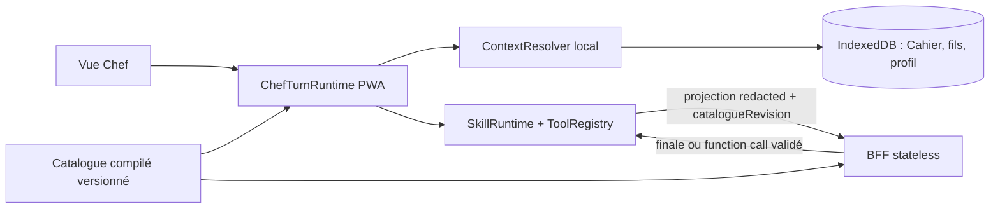
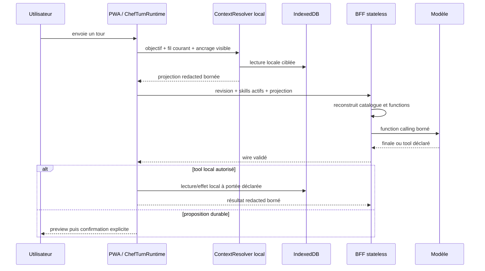

# Architecture Spine — Chef C&C

## Design Paradigm

**Client-orchestrated tool protocol**, étendu par un **catalogue compilé local**. La PWA possède les données, résout le contexte du tour, active les skills et applique les effets. Le BFF stateless reconstruit les instructions et définitions de function calling depuis le même catalogue versionné ; il ne reçoit que la projection temporaire minimale.



## Inherited Invariants

| Inherited | From parent | Binds here |
| --- | --- | --- |
| AD-1 Client is SoR | `architecture-cooks-n-coqs-2026-08-11` | Cahier, fils, profil et tout contexte personnel restent locaux. |
| AD-2 Dependency direction | same | La PWA peut importer les packages partagés ; le BFF n'importe jamais `apps/web`. |
| AD-3 Domain owns shared recipe rules | same | Les wires et validateurs de tour partagés vivent aussi dans `packages/domain`, avec leurs jumeaux `.ts`/`.js`. |
| AD-4 BFF boundary & secrets | same | Les clés cloud restent côté BFF, sans faire de lui un système de données utilisateur. |
| AD-5 Resilience & progressive enhancement | same | L'indisponibilité IA ne supprime ni saisie ni état local et conserve le repli 9.2. |
| AD-8 Normative doc governance | same | Toute future livraison structurelle réconcilie les documents normatifs et l'ADR. |
| AD-12 Recipe write gate | same | Une recette durable ne passe que par le gate de sauvegarde explicite existant. |

## Invariants & Rules

### AD-1 — Client orchestrateur, BFF stateless [ADOPTED]

- **Binds:** toutes les capacités Chef.
- **Prevents:** une lecture ou une persistance serveur implicite du Cahier.
- **Rule:** le client transmet seulement le contexte utile et borné à une requête précise ; le BFF ne conserve aucun état utilisateur.

### AD-2 — Propriété locale des données utilisateur [ADOPTED]

- **Binds:** Cahier, contexte d'écran, profil Chef, préférences et apprentissages.
- **Prevents:** un second système de vérité côté BFF.
- **Rule:** ces données vivent sur l'appareil ; le BFF ne les traite qu'en extrait éphémère.

### AD-3 — Outils client-médiés [ADOPTED]

- **Binds:** recherche Cahier, extrait écran/recette/profil, écritures mémoire.
- **Prevents:** accès général du BFF à l'appareil.
- **Rule:** le BFF demande une capacité nommée et un payload minimal structuré ; le client vérifie et exécute lecture ou écriture.

### AD-4 — Mutations différenciées [ADOPTED]

- **Binds:** mémoire Chef, recettes, plans et quantités.
- **Prevents:** une mutation durable non consentie.
- **Rule:** invariant explicite mémorisable silencieusement ; inférence à faible confiance ; recette, plan ou quantité prévisualisés puis confirmés.

### AD-5 — Cycle et animation locaux [ADOPTED]

- **Binds:** conversation, annulation, rendu et six animations.
- **Prevents:** animation réseau retardée ou réponses tardives appliquées.
- **Rule:** le client déclenche les états ; le BFF peut les suggérer sémantiquement. Le client invalide les réponses tardives.

### AD-6 — Proactivité opt-in [ADOPTED]

- **Binds:** suggestions et notifications.
- **Prevents:** relances spontanées non demandées.
- **Rule:** seuls des rituels explicitement activés autorisent une notification locale ou une demande ponctuelle au BFF.

### AD-7 — Portabilité du profil Chef [ADOPTED]

- **Binds:** export/import Cahier et profil Chef.
- **Prevents:** un changement ou reset d'appareil qui restaure les recettes mais efface les apprentissages utiles.
- **Rule:** le transfert local versionné inclut les données Chef structurées nécessaires (préférences, contraintes, foyer, observations et confiance), mais exclut conversations, prompts, transcriptions, images et historique brut. L'import valide et fusionne le profil localement, sans persistance BFF.

### AD-8 — Journal local de conversations [ADOPTED]

- **Binds:** fils Assistant et fils de séance cuisine.
- **Prevents:** une conversation infinie ou un journal côté BFF.
- **Rule:** les fils sont des données utilisateur locales distinctes du profil et des recettes ; ils sont datés, contextualisables et supprimables. Nouvelle conversation clôt le fil actif, une séance cuisine ouvre son fil dédié et l'accueil ne reprend que le dernier fil pertinent au premier lot.

### AD-9 — Catalogue Chef compilé, embarqué et versionné [ADOPTED]

- **Binds:** skills Chef, définitions de tools, prompts de capability, PWA, BFF et build CI.
- **Prevents:** deux littéraux TypeScript ou prompts divergents ; téléchargement de compétences ; un BFF qui accepte des instructions ou définitions arbitraires du navigateur.
- **Rule:** `packages/chef-catalog/` est l'unique source versionnée des `skills/<id>/SKILL.md` (frontmatter, dépendances, résumé et instructions) et `tools/<id>/TOOL.md` (intention, conditions, classification des données, allow-lists de champs, clés de limites et politique d'effet), référencés à des schémas JSON Schema Draft 2020-12 d'entrée et de résultat. Chaque tool nomme son exécuteur `local` ou son adaptateur BFF, ses projections d'entrée/résultat et exactement un effet parmi `none`, `local_read`, `bff_read`, `session_reversible`, `explicit_preference`, `inferred_preference_low_confidence` ou `preview_then_confirm` ; aucun exécuteur n'a d'accès générique à IndexedDB ou au réseau. Les allow-lists sont toujours intersectées avec une deny-list compilée non contournable : IDs locaux, `File`, `Blob`, URL `blob:`, binaires/images source, profil/préférences/mémoire bruts, Cahier/fil complets, prompt système et raisonnement. Un compilateur déterministe valide identifiants uniques, références, fermeture des dépendances, cycles, schémas, projections, politiques et fraîcheur des artefacts, puis émet un manifeste immuable avec `catalogRevision` pour les bundles PWA et BFF. Toute erreur ou artefact généré périmé échoue au build ; aucun fichier de catalogue n'est téléchargé ni interprété depuis le réseau au runtime.

### AD-10 — Tour local : contexte résolu, registre actif et function calling bornés [ADOPTED]

- **Binds:** `ChefTurnRuntime`, `ContextResolver`, activation de skills, appels de tools, recherche conversationnelle, BFF `/api/assistant/agent` et annulation.
- **Prevents:** accès global à IndexedDB ou au réseau ; injection de prompt depuis le fil ; perte silencieuse d'un objectif ambigu ; contextes complets envoyés au BFF ; appels hors registre ou résultats non redacted.
- **Rule:** chaque tour commence avec `chef-core`, qui n'annonce au modèle que le résumé des skills disponibles et peut demander `activate_skill`. La PWA valide l'activation contre le catalogue, résout ses dépendances et ajoute seulement ses instructions et tools au registre actif ; toute entrée active porte une provenance `bootstrap` ou `function_call` et est traçable. `packages/domain` possède le `ChefAgentTurnWireV2` fermé et ses validateurs `.ts`/`.js` : `catalogRevision`, nonce éphémère non persistant, étape monotone, skills actifs et projection ; chaque décision ou résultat doit porter le nonce et l'étape encore actifs. Le `ContextResolver` local maintient objectif actif/suspendu, clarification ouverte, ancrage explicitement cité ou visible et état de recherche ; une ambiguïté suspend ou clarifie, sans détruire l'objectif précédent. Il est seul propriétaire de la projection LLM ; un exécuteur peut lire seulement par le service déclaré de son tool et ne retourne que la projection compilée. La projection est bornée par `ChefRuntimeLimitsV1` : message courant, objectif et clarification pertinents, ancrage redacted, résultats de tools validés et seulement l'extrait récent nécessaire. La recherche par défaut est limitée au fil courant ; un fil clos ne peut être consulté qu'après signal explicite vers le passé et par un tool local à portée déclarée. Le BFF accepte seulement une révision de catalogue qu'il possède, reconstruit localement instructions et définitions de function calling, valide les IDs actifs et retourne une finale ou un appel déclaré ; il n'accepte jamais instructions, schémas, exécuteurs ou résultats arbitraires du navigateur. Une révision incompatible renvoie le refus typé `catalog_mismatch` : ce décalage de déploiement est un refus sûr, la PWA arrête la boucle sans tool ni persistance et reprend 9.2. La PWA valide le schéma, le budget, la portée, la redaction, l'annulation et la politique d'effet avant exécution ; aucun tool ne reçoit URL ou capacité `fetch` arbitraire et seul `BffToolAdapter` résout un adaptateur statique déclaré, jamais un endpoint choisi par le modèle. Une préférence explicitement exprimée peut suivre AD-4 seulement via le service local de profil avec accusé visible ; une inférence doit être `inferred_preference_low_confidence`, porter provenance et confiance, et passer uniquement par ce même service local ; toute recette reste une preview, puis une confirmation et `RecipeService` conformément à l'AD-12 parent. Appel hors registre, schéma invalide, dépassement de budget, refus local, résultat non redacted, annulation, réponse tardive ou absence de progrès arrête le tour sans écriture et reprend le repli 9.2 lorsque l'échec n'est pas une annulation.

### AD-11 — Évaluation agentique en deux niveaux [ADOPTED]

- **Binds:** catalogue/registre, `ContextResolver`, traces de tour, tests unitaires et intégration, Playwright et juge LLM optionnel.
- **Prevents:** une régression de confidentialité ou de sécurité masquée par une réponse plausible ; données personnelles dans les jeux d'essai ; un juge LLM qui annule une règle déterministe.
- **Rule:** les scénarios Chef emploient des fixtures locales synthétiques et produisent des traces redacted bornées (révision de catalogue, skills activés, appels/refus, résultats réduits, transitions, sortie visible redacted et motif d'arrêt), sans prompt complet, raisonnement, identifiant local ni contenu personnel. Les assertions déterministes sont bloquantes pour compilation de catalogue, schémas, registre, redaction, budgets, annulation, réponses tardives, confirmation, non-écriture, `catalog_mismatch` et interdiction de recherche silencieuse dans les fils clos. Des parcours Playwright couvrent les références de carte, clarification/reprise, recherche de fil courant, erreur et réponse tardive. Un juge LLM séparément configuré ne reçoit que fixtures et traces redacted ; il évalue pertinence, continuité et honnêteté selon une grille versionnée, reste consultatif et ne peut jamais valider un échec déterministe ni remplacer une revue humaine.

## Consistency Conventions

| Concern | Convention |
| --- | --- |
| Catalogue | Markdown source versionné dans `packages/chef-catalog`; seul le manifeste compilé est importable au runtime. `catalogRevision` doit correspondre exactement entre PWA et BFF. |
| Capacités | `skill` donne du contexte, `tool` donne une opération déclarée. Toute requête, résultat et refus suit le schéma compilé ; aucune action personnelle implicite. |
| Contexte | `ContextResolver` est l'unique propriétaire de la projection LLM ; les exécutants ne lisent que le service déclaré par leur tool. Les IDs restent dans la PWA et toute projection applique l'allow-list compilée. |
| Budgets | `ChefRuntimeLimitsV1` est le contrat unique des plafonds de taille, steps, tools, délai et extrait ; client et BFF l'appliquent indépendamment. |
| Mémoire | observation structurée, provenance, confiance, correction/suppression locale. |
| UI | état Chef piloté localement ; mouvement réduit respecté ; `activate_skill` et les tools n'exposent ni raisonnement ni détail technique. |
| Évaluation | fixture + trace redacted d'abord ; verdict LLM facultatif et jamais sécuritaire. |

## Stack

| Name | Version |
| --- | --- |
| Node | 20.x |
| TypeScript | ^5.8.2 |
| Vue | ^3.5.13 |
| Dexie | ^4.0.10 |
| Express | ^4.21.2 |
| openai | ^6.25.0 |
| JSON Schema | Draft 2020-12 |

## Structural Seed

```text
packages/
  domain/src/chef-agent.*                   # ChefAgentTurnWireV2 + validateurs partagés
  chef-catalog/
    skills/<skill-id>/SKILL.md             # frontmatter + instructions versionnés
    tools/<tool-id>/TOOL.md                # intention, portée, effet, références schéma
    schemas/<tool-id>.{input,result}.json  # JSON Schema Draft 2020-12
    src/generated/catalog.ts                # seul artefact importé PWA / BFF
scripts/
  compile-chef-catalog.ts                   # validation + génération déterministes
apps/web/src/chef-runtime/
  context-resolver.ts                       # projection locale et recherche de fil
  skill-runtime.ts                          # activation validée et registre actif
  tool-executors/                           # adaptateurs locaux, aucun accès générique
apps/bff/src/
  chef-agent-catalog.ts                     # résolution serveur du manifeste compilé
  chef-agent-function-calling.ts            # appel modèle et validation wire stateless
```



## Capability → Architecture Map

| Capability / Area | Lives in | Governed by |
| --- | --- | --- |
| conversation et invocation | client Vue / session Chef | AD-1, AD-5 |
| Cahier contextualisé | outil client + service existant | AD-2, AD-3 |
| mémoire et préférences | profil local Chef | AD-2, AD-4 |
| génération et raisonnement | BFF | AD-1, AD-3 |
| notification opt-in | PWA client | AD-6 |
| export/import du profil Chef | transfert Cahier local | AD-2, AD-7 |
| continuité des échanges | journal local de conversations | AD-2, AD-8 |
| catalogue Skills/Tools | `packages/chef-catalog` + compilateur | AD-9 |
| activation, contexte et function calling | `ChefTurnRuntime`, `ContextResolver`, registre et adaptateurs BFF | AD-10 |
| évaluation et non-régression | fixtures, traces, Node tests, Playwright, juge LLM optionnel | AD-11 |

## Deferred

- Valeurs exactes de `ChefRuntimeLimitsV1` et forme complète des projections : à geler dans la SPEC 9.5, avec tests de frontière ; elles ne peuvent pas être choisies séparément par PWA et BFF.
- Bibliothèque de validation JSON Schema : choisir à l'implémentation si elle valide strictement les artefacts compilés Draft 2020-12 ; elle ne change ni les schémas ni le wire.
- Recherche sémantique/RAG local : hors 9.5. Reconsidérer seulement si l'index/extrait local déclaré ne résout pas des cas mesurés ; aucune donnée de Cahier ne devient un corpus BFF.
- Recherche dans les fils clos : le contrat technique exige un signal explicite ; l'expérience exacte de sélection/confirmation reste à spécifier avant livraison.
- Schéma exact du profil Chef, du journal, leur politique de rétention/export et les payloads de mémoire : à fixer dans les épics 7.x.
- Technologie et exports définitifs de l'asset animé : traités par le motion spike.
- Planification des repas et listes de courses : hors premier lot Chef.
